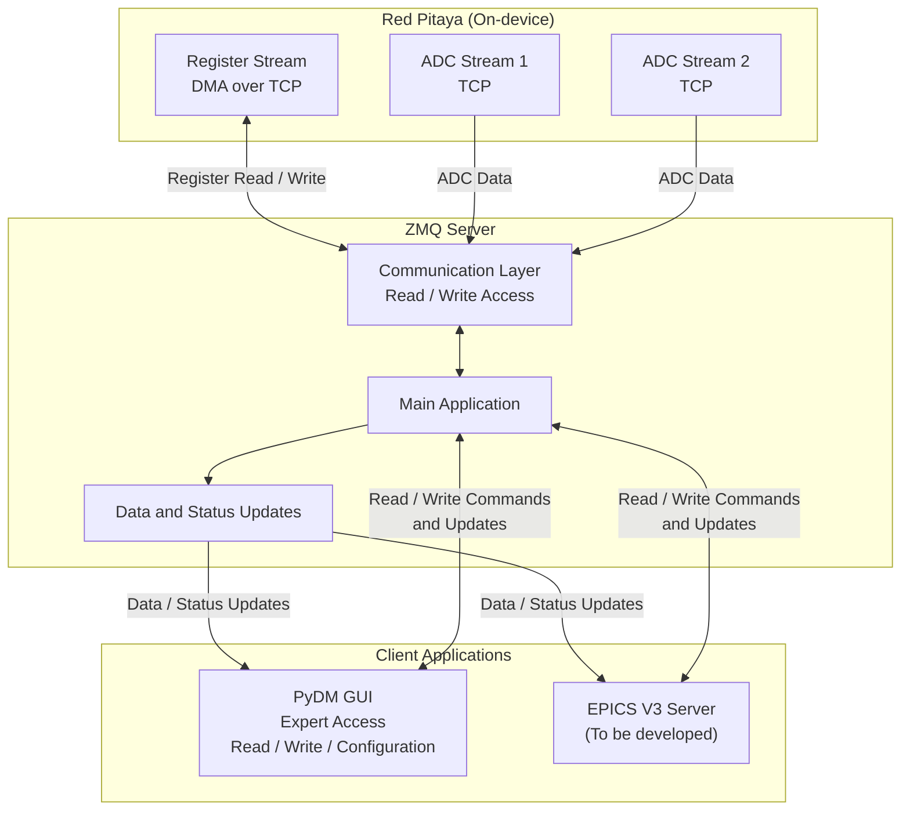

# Overview

## Rough system architecture

- **On-device (Red Pitaya):**
  - Register stream: DMA-based data transfer over TCP.
  - ADC Stream 1: TCP data stream mapped to ADC 1.
  - ADC Stream 2: TCP data stream mapped to ADC 2.

- **ZMQ Server:**
  - Hosts and runs the main application.
  - Handles communication with the Red Pitaya.
  - Forwards read and write access requests between clients and the device.
  - Distributes device data and status updates to connected clients.

- **PyDM GUI (Expert Access):**
  - Connects to the ZMQ Server.
  - Provides expert-level access to the system.
  - Supports both read and write operations through the ZMQ Server.
  - Allows experts to monitor, control, and configure the system.

- **EPICS V3 Server (to be developed):**
  - Connects to the ZMQ Server.
  - Listens for device data and status updates.
  - Exposes system parameters through EPICS V3 PVs.
  - Handles system configuration and control through the ZMQ Server.

## System architecture flowchart



## Communication overview

| Component | Communication | Purpose |
|---|---|---|
| Red Pitaya ↔ ZMQ Server | TCP | Register access and ADC data streaming |
| PyDM ↔ ZMQ Server | ZMQ | Expert access, monitoring, control, and configuration (read/write) |
| EPICS V3 ↔ ZMQ Server | ZMQ (to be implemented) | PV updates, monitoring, and configuration |

**Note:** The ZMQ Server acts as the central communication and control layer. PyDM provides direct expert-level read/write access through ZMQ, while the EPICS V3 server will provide a standardized EPICS interface for integration with the wider control system.

# Installation

## Git and Submodules

1. Set up SSH key authentication for `github.com`.
2. Clone the repository recursively, including all submodules:

   ```bash
   git clone --recursive git@github.com:hyin0986/claws.git
   ```

## Install Miniforge

`Miniforge` is a lightweight, community-maintained installer for the Conda and Mamba package managers. It is preconfigured to download packages exclusively from the free and open-source `conda-forge` channel by default.

`rogue` is distributed through Miniforge. To install Miniforge, run:

```bash
wget -O Miniforge3.sh "https://github.com/conda-forge/miniforge/releases/latest/download/Miniforge3-$(uname)-$(uname -m).sh"
bash Miniforge3.sh
```

The default installation location is `${HOME}/miniforge3`.

To initialize Conda in your current shell session, run:

```bash
source "${HOME}/miniforge3/etc/profile.d/conda.sh"
```

### Create a Conda Environment

The repository provides an `environment.yml` file that specifies:

- **Environment name:** `claws_env`
- **Package channels:**
  - `tidair-tag` (`rouge`)
  - `conda-forge` (default)
- **Dependencies:**
  - `rogue`
  - `surf`

To create the `claws_env` Conda environment, run:

```bash
PIP_NO_BUILD_ISOLATION=0 conda env create -f environment.yml
```

The `PIP_NO_BUILD_ISOLATION=0` setting is required by `surf`.

Once the environment has been created, activate it using:

```bash
conda activate claws_env
```

To deactivate the environment, run:

```bash
conda deactivate
```

**Note:**

Installing `surf` directly through `pyproject.toml` is also possible, but requires additional packages and installation arguments (e.g., `GitPython` and `--no-build-isolation`).

### Set Up the Python Virtual Environment and Development Dependencies

Most graphical editors use Python virtual environments (`venv`) to manage project dependencies and language server configurations.

To create a Python virtual environment on top of `claws_env`, first activate the Conda environment if it is not already active:

```bash
source "${HOME}/miniforge3/etc/profile.d/conda.sh"
conda activate claws_env
```

Create a Python virtual environment with access to the packages installed in the Conda environment:

```bash
python3 -m venv --system-site-packages .venv
```

For development, you can create the `.venv` directory directly in the repository root.

The resulting virtual environment uses the Python interpreter and system packages provided by `claws_env`. Additional Python packages installed through `pip` are isolated within `.venv`.

After creating the virtual environment, you can deactivate the Conda environment:

```bash
conda deactivate
```

To activate the Python virtual environment, run:

```bash
source .venv/bin/activate
```

To deactivate it, run:

```bash
deactivate
```

The virtual environment can be removed by simply deleting the `.venv` directory:

```bash
rm -rf .venv
```

**Note:**

Once `.venv` has been created with `--system-site-packages`, activating it provides access to the packages installed in the underlying Conda environment.

You no longer need to manually run the following commands every time you activate `.venv`:

```bash
source "${HOME}/miniforge3/etc/profile.d/conda.sh"
conda activate claws_env
```


### Set Up the `claws` Python Package for Development

**Note:** Creating the `claws_env` Conda environment is required for both development and deployment. The difference is in how the `claws` Python package itself is installed.

For deployment, install the package directly from the Git repository:

```bash
pip install git+<repository-url>
```

For development, navigate to the repository root and activate the Python virtual environment:

```bash
source .venv/bin/activate
```

Install the package in editable mode, including the development dependencies:

```bash
pip install -e ".[dev]"
```

The `-e` option installs the package in editable mode by linking it to the source directory. Consequently, changes to the source code do not require reinstalling the package.

The `[dev]` extra specifies additional development dependencies, such as:

- `ruff` - code linting and formatting
- `mypy` - static type checking
- `sphinx` - documentation generation
- `pytest` - automated testing

The following command-line entry points are available after installation:

- `claws_server` - starts the ZeroMQ (ZMQ) server.
- `claws_pydm` - starts the PyDM implementation.

```console
(.venv) $ claws_server
Rogue/pyrogue version v6.16.0. https://github.com/slaclab/rogue
Start: Started zmqServer on ports 9099-9101
    To start a gui: python -m pyrogue gui --server='localhost:9099'
    To use a virtual client: client = pyrogue.interfaces.VirtualClient(addr='localhost', port=9099)
Running. Hit cntrl-c or send SIGTERM to 1179013 to exit.
```
